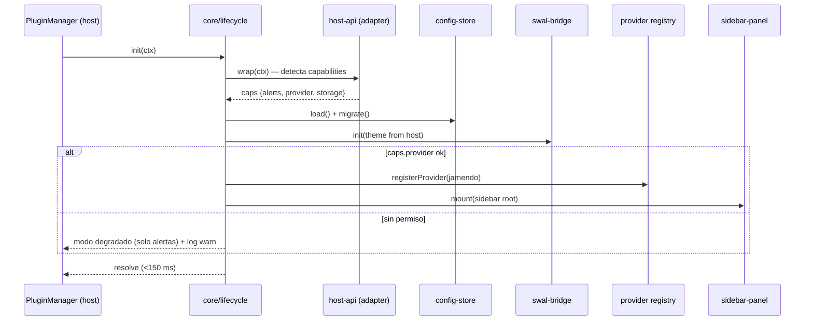

# 🗺️ Roadmap — Addon Strimio «SweetAlert Provider Bridge»

> **Versión:** 1.0 · **Fecha:** 2026-11-13 · **Estado:** Aprobado para ejecución
> **Documento base:** [`reporte-analisis-tecnico.html`](./reporte-analisis-tecnico.html) (Fase 0 — análisis de stack, tipos, requisitos, criterios de aceptación y lenguaje)
> **Proyecto:** Addon para [Strimio](https://www.strimio.com/) (desktop music player, Electron + React + Redux). Tipo híbrido **Provider (A) + Tool/UI (C)**: registra un proveedor de catálogo libre (Jamendo / Internet Archive) y aporta un bridge de alertas con SweetAlert2.

---

## Índice

1. [Visión, objetivo y alcance](#1-visión-objetivo-y-alcance)
2. [Resumen ejecutivo del plan](#2-resumen-ejecutivo-del-plan)
3. [Arquitectura](#3-arquitectura)
4. [Estructura de carpetas](#4-estructura-de-carpetas)
5. [Dependencias](#5-dependencias)
6. [Módulos](#6-módulos)
7. [Diagramas](#7-diagramas)
8. [Backlog priorizado (historias de usuario)](#8-backlog-priorizado-historias-de-usuario)
9. [Desglose WBS por fases y tareas](#9-desglose-wbs-por-fases-y-tareas)
10. [Cronograma y hitos](#10-cronograma-y-hitos)
11. [Estimación](#11-estimación)
12. [Plan de pruebas](#12-plan-de-pruebas)
13. [Criterios de aceptación y DoD](#13-criterios-de-aceptación-y-dod)
14. [Métricas y KPIs](#14-métricas-y-kpis)
15. [Riesgos y mitigación](#15-riesgos-y-mitigación)
16. [Plan de releases](#16-plan-de-releases)
17. [Proceso de trabajo](#17-proceso-de-trabajo)
18. [Anexos](#18-anexos)

---

## 1. Visión, objetivo y alcance

### Visión
Mejorar la experiencia de notificaciones y descubrimiento musical en Strimio: alertas/modales elegantes y accesibles (SweetAlert2) integradas con el tema del host, más un proveedor de música de catálogo libre que se integra al pipeline de playback nativo — sin tocar el código de Strimio, usando únicamente su API pública de addons.

### Objetivo del proyecto (SMART)
Entregar **v1.0.0 estable** publicada en el market de Strimio en **≤ 17 semanas**, con cobertura de tests ≥ 80 %, bundle ≤ 300 KB gzip, tasa de crash atribuible al addon ≈ 0 y ≥ 20 usuarios beta activos.

### Dentro del alcance (v1.0)
- Bridge de alertas: `notify()`, `confirm()`, `error()`, `nowPlaying()` con cola, temas claro/oscuro e i18n es/en.
- Proveedor único activo: **Jamendo** (adaptador secundario **Internet Archive** como feature flag "experimental").
- Panel lateral de búsqueda con paginación, caché TTL 15 min y reproducción delegada al host.
- Configuración persistente, modo seguro por permisos, desinstalación limpia, CI/CD, ficha de market.

### Fuera del alcance (v1.x futuro)
- Soporte de más de un provider simultáneo, playlists sincronizadas, letras, escrobbler, portales web del addon, distribución fuera del market oficial.

### Supuestos críticos (heredados del informe F0)
- **S-1:** El contrato del host (`init(ctx)/destroy()`, `registerProvider`, hooks) sigue los patrones documentados; **la tarea V-01 lo verifica contra `docs.strimio.com` y el repo `Strimio/docs` antes de congelar interfaces**. Si cambia, el impacto se absorbe en la capa `host-api` (coste estimado: +1 sprint).
- **S-2:** El loader permite bundlear dependencias propias (SweetAlert2). Verificado en spike S-01; plan B documentado en R-02.

---

## 2. Resumen ejecutivo del plan

| Fase | Nombre | Sprint | Duración | Puntos | Hito de salida |
|---|---|---|---|---|---|
| F0 | Análisis técnico (informe HTML) | S0 | 1 sem | 3 ✔ | Reporte entregado ✅ |
| F1 | Preparación & spikes | S1–S2 | 2 sem | 8 | Hello-world cargando en Strimio + CI verde |
| F2 | Núcleo de alertas (MVP) | S3–S5 | 3 sem | 13 | MVP alertas usable + demo CA-2.x |
| F3 | Provider de música | S6–S9 | 4 sem | 21 | E2E buscar→reproducir verde |
| F4 | Calidad & empaque | S10–S11 | 2 sem | 8 | v0.9.0 beta publicado |
| F5 | Estabilización & release | S12–S13 | 2 sem | 5 | **v1.0.0 stable** en market |
| | **Total** | **13+1** | **14 sem** | **58** | Buffer +20 % ⇒ **ventana realista 16–17 sem** |

**Ruta crítica:** V-01 → S-01 → scaffold → swal-bridge → provider-client → panel UI → E2E → beta → release. Cualquier retraso en V-01/S-01 desplaza todo el proyecto: se atacan primero.

---

## 3. Arquitectura

### 3.1 Principios
1. **Adapter defensivo:** solo `src/host-api/` toca el contexto del host; todo lo interno habla contra interfaces propias (`HostApi`). Si el host cambia, se adapta una sola capa.
2. **Boundary try/catch:** ninguna excepción del addon se propaga a Strimio (RNF-04). Toda API pública envuelve ejecuciones y enruta errores a logger + alerta.
3. **Mínimo privilegio:** permisos declarados = permisos usados; sin `eval`, URLs https-only, sanitización de HTML externo.
4. **Degradaación elegante:** sin permiso de provider → el addon funciona solo como bridge de alertas (RF-15).
5. **Autocontención:** bundle CJS único (`dist/main.js`) con CSS inyectado namespaced `.swal-provider-*`; cero dependencias del runtime del host.

### 3.2 Componentes

| # | Componente | Responsabilidad | Requisitos cubiertos |
|---|---|---|---|
| C1 | `manifest.json` | Identidad, permisos, engines, icon | RF-02 |
| C2 | `core/lifecycle` | Orquestación init/destroy, registro de subscriptions | RF-01, RF-17, RNF-03 |
| C3 | `host-api` | Adapter del ctx del host (capabilities, hooks, playback) | RF-01, R-01 |
| C4 | `alerts/swal-bridge` | API notify/confirm/error/nowPlaying sobre SweetAlert2 | RF-03 |
| C5 | `alerts/queue` | Serialización de modales (máx 1), toasts apilados (máx 3) | RF-11, CA-2.4 |
| C6 | `alerts/themes` | Tema claro/oscuro desde el host, variables CSS | RF-12, CA-2.3 |
| C7 | `core/config-store` | Settings persistentes + migraciones | RF-08, RF-18, CA-4.x |
| C8 | `provider/jamendo-client` | Llamadas a API Jamendo (search, pagination) | RF-04, RF-05 |
| C9 | `provider/archive-client` | Adaptador Internet Archive (feature flag) | R-03 |
| C10 | `provider/normalize` | Mapeo a modelo canónico `Track` | RF-05, RF-06 |
| C11 | `provider/cache` | TTL 15 min resultados + portadas | RF-10, CA-3.3 |
| C12 | `ui/sidebar-panel` | Panel de búsqueda/lista/paginación ▶ | RF-04..06, CA-3.x |
| C13 | `ui/settings-view` | Formulario de configuración | RF-08 |
| C14 | `core/logger` | Log estructurado en userData/addons/<id>/logs | RF-16 |
| C15 | `core/errors` | Taxonomía de errores → plantillas de alerta | RF-07 |
| C16 | `i18n` | Diccionarios es/en + detección idioma host | RF-13 |

### 3.3 Decisiones registradas (ADR resumidos)

| ID | Decisión | Alternativas descartadas | Justificación |
|---|---|---|---|
| ADR-1 | TypeScript estricto (ES2020/CJS) | JS plano, compile-to-JS ligero | Tipos compartidos host/addon, seguridad de refactor, requisito RNF-09 |
| ADR-2 | esbuild como bundler | webpack, rollup | Velocidad (<2 s), output CJS único, tree-shaking de SweetAlert2 |
| ADR-3 | SweetAlert2 bundled (no CDN) | overlay propio, notificaciones nativas Electron | Madurez/a11y del proyecto, offline-safe, CSP-compatible |
| ADR-4 | Un solo adaptador `CatalogProvider` activo con registry | providers múltiples | Complejidad mínima viable; extensible post-v1 |
| ADR-5 | Playback delegado al host (nunca `<audio>` propio) | reproductor embebido | Coherencia de UX, menos memoria, respeta media keys del host |
| ADR-6 | Jest+jsdom unit/integration; Playwright E2E | Cypress | jsdom rápido para lógica; Playwright soporta Electron/apps desktop multi-OS |

---

## 4. Estructura de carpetas

```
strimio-addon/
├── manifest.json              # id, version, apiVersion, type, permissions, engines  [Tarea T1.2]
├── package.json               # scripts dev/build/test/package
├── tsconfig.json              # strict:true, target ES2020, module CommonJS
├── esbuild.config.mjs         # bundle CJS -> dist/main.js (+ css inyectado)
├── jest.config.ts             # preset jsdom, setup mocks de HostContext
├── playwright.config.ts       # E2E sobre Strimio instalado
├── .github/workflows/ci.yml   # lint -> type-check -> test -> build -> audit -> package zip
├── .github/workflows/release.yml
├── src/
│   ├── main.ts                # export { init, destroy } — composición de módulos
│   ├── types/                 # host-context.d.ts · track.model.ts · settings.ts
│   ├── core/                  # lifecycle.ts · config-store.ts · logger.ts · errors.ts · subscription-registry.ts
│   ├── host-api/              # adapter.ts · capabilities.ts · contract-tests
│   ├── alerts/                # swal-bridge.ts · templates.ts · queue.ts · themes.css
│   ├── provider/              # jamendo-client.ts · archive-client.ts · normalize.ts · cache.ts · catalog.interface.ts
│   ├── ui/                    # sidebar-panel.ts · settings-view.ts · dom-helpers.ts
│   └── i18n/                  # index.ts · locales/es.json · locales/en.json
├── assets/                    # icon.png (256px) · preview-market.png · screenshots/
├── tests/
│   ├── unit/                  # *.test.ts por módulo
│   ├── integration/           # stub PluginManager carga dist/main.js real
│   ├── fixtures/              # respuestas API grabadas (Jamendo/IA)
│   └── e2e/                   # flujos H1–H4 (instalar→buscar→reproducir→alertar→desinstalar)
├── docs/                      # este roadmap · README · API interna · CONTRIBUTING · CHANGELOG
└── scripts/                   # bench.mjs · leak-check.mjs · validate-manifest.mjs
```

---

## 5. Dependencias

### 5.1 Runtime (`dependencies`)
| Paquete | Versión | Uso | Impacto bundle (gzip aprox.) |
|---|---|---|---|
| sweetalert2 | ^11.x | Modales/toasts accesibles | ~90 KB |

*(Objetivo RNF-02: total ≤ 300 KB gzip; presupuesto: swal 90 + código addon 60 + CSS 15 + colchón).*

### 5.2 Desarrollo (`devDependencies`)
| Categoría | Paquete | Versión |
|---|---|---|
| Lenguaje/build | typescript, esbuild | ≥5.4 / ≥0.21 |
| Tests | jest, ts-jest, jest-environment-jsdom | ≥29 |
| E2E | @playwright/test | ≥1.44 |
| Calidad | eslint, @typescript-eslint/*, prettier | ≥8 / ≥7 |
| Utilidades | rimraf, concurrently | latest |
| Seguridad | npm audit (CI), sinon | — |

### 5.3 Externos al repositorio
- Strimio ≥ 3.0 (entorno de prueba local, no empaquetado).
- API Jamendo (client_id gratuito, límite de uso documentado) / Internet Archive (sin key).
- Node.js ≥ 20 LTS para toolchain.

### 5.4 Política de dependencias
- 0 dependencias transitivas de red en runtime; `npm audit --audit-level=high` bloqueante en CI; Renovabe mensual agrupado; licencias solo MIT/Apache-2.0.

---

## 6. Módulos

Contratos internos (firmados al final de F1, congelados en gate G1):

| Módulo | API pública | Depende de | Cobertura mínima |
|---|---|---|---|
| `core/lifecycle` | `init(ctx): Promise<void>` · `destroy(): Promise<void>` | host-api, config, alerts, provider, ui | 85 % |
| `host-api` | `getCapabilities()`, `onTheme(cb)`, `onTrackChange(cb)`, `play(track)`, `storage.get/set`, `registerProvider(p)` | ctx del host | 90 % (contract tests) |
| `alerts/swal-bridge` | `notify(msg, opts)`, `confirm(opts): Promise<boolean>`, `error(err, {retry})`, `nowPlaying(track)` | queue, themes, i18n, sweetalert2 | 85 % |
| `alerts/queue` | `push(job)` — serializa modales, apila toasts (máx 3) | — | 90 % |
| `core/config-store` | `get<K>()`, `set<K,v>()`, `reset()`, `migrate(from,to)` | host-api.storage | 85 % |
| `provider/jamendo-client` | `search(q, page): Promise<TrackPage>` | fetch, cache | 80 % (fixtures) |
| `provider/normalize` | `toTrack(raw): Track \| null` | types | 95 % |
| `provider/cache` | `get/set(key, ttl=900s)` | — | 90 % |
| `ui/sidebar-panel` | `mount(root)`, `unmount()` | provider, alerts, i18n | 75 % (DOM) |
| `core/logger` | `debug/info/warn/error(meta)` | host fs via ctx | 80 % |

**Regla de arquitectura verificable en CI:** importaciones permitidas solo hacia abajo (ui→provider/alerts→core→host-api); `eslint-plugin-import` + script `check-layers.mjs`.

---

## 7. Diagramas

### 7.1 Contexto (C4 nivel 1)

```
┌────────────────────────────── Strimio (Electron) ──────────────────────────────┐
│  Renderer: PluginManager ──► carga addon ──► init(ctx)                          │
│  Player/Playback ◄────────── host-api.play(track) ──────────┐                  │
│  Theme/Events  ─────────────► onTheme/onTrackChange ────────┤                  │
│                                                             ▼                  │
│                              ┌────────────────────────────────────────┐        │
│                              │  ADDON: SweetAlert Provider Bridge     │        │
│                              │  alerts ⇄ provider ⇄ ui ⇄ core         │        │
│                              └───────┬───────────────────┬────────────┘        │
│                                      │ HTTPS             │ localStorage-like   │
└──────────────────────────────────────┼───────────────────┼─────────────────────┘
                                       ▼                   ▼
                            api.jamendo.com        userData/addons/<id>/
                            archive.org            (settings + logs)
```

### 7.2 Secuencia de carga (init)



### 7.3 Flujo buscar → reproducir con error handling

```mermaid
flowchart TD
    A[Usuario escribe query] --> B{cache TTL válido?}
    B -- sí --> E[render lista]
    B -- no --> C[jamendo.search q,page]
    C -- éxito --> D[normalize → Track[]] --> F[cache.set] --> E
    C -- fallo red --> G[alerts.error 'sin conexión' + Reintentar]
    G -. reintento .-> C
    E --> H[click ▶]
    H --> I[host-api.play streamUrl]
    I -- ok --> J[hook trackChange → toast nowPlaying]
    I -- err --> K[alerts.error playback + Reintentar]
```

### 7.4 Máquina de estados del addon

```
INSTALLED ─activate→ LOADING ─init ok→ ACTIVE ⇄ (settings change) ACTIVE
   │                    │fault              │deactivate→ DESTROYING → INSTALLED
   │                    ▼                   ▼
   └──────────── BLOCKED (apiVersion/permiso)   SAFE_MODE (provider sin permiso)
```

### 7.5 Despliegue / pipeline

```
PR → lint+type-check → unit+integration (jest) → build esbuild → size-check ≤300KB
   → npm audit + domain-whitelist → package zip + checksum
tag vX.Y.Z → release.yml → GitHub Release (zip) → sumisión manual market Strimio
nightly → Playwright E2E (win/mac/linux) + bench + axe-core
```

---

## 8. Backlog priorizado (historias de usuario)

Formato: *Como… quiero… para…* · Prioridad MoSCoW · Puntos (Fibonacci) · Fase.

| ID | Historia | Prioridad | PTS | Fase | CAs asociadas |
|---|---|---|---|---|---|
| HU-01 | Como usuario, quiero instalar y activar el addon sin reiniciar Strimio, para usarlo de inmediato. | Must | 3 | F1 | CA-1.1, CA-1.2 |
| HU-02 | Como usuario, quiero ver alertas estilizadas ante errores de playback con botón "Reintentar". | Must | 5 | F2 | CA-2.1 |
| HU-03 | Como usuario, quiero diálogos de confirmación consistentes (Esc/click-fuera configurables). | Must | 3 | F2 | CA-2.2 |
| HU-04 | Como usuario, quiero que las alertas respeten el tema claro/oscuro del host. | Should | 3 | F2 | CA-2.3 |
| HU-05 | Como usuario, quiero que los toasts se apilen máximo 3 y los modales nunca se superpongan. | Should | 2 | F2 | CA-2.4 |
| HU-06 | Como oyente, quiero buscar música libre desde la barra lateral y ver título/artista/portada en <2 s. | Must | 8 | F3 | CA-3.1 |
| HU-07 | Como oyente, quiero pulsar ▶ y que Strimio reproduzca la pista con metadatos correctos. | Must | 5 | F3 | CA-3.2 |
| HU-08 | Como usuario offline, quiero saber que no hay conexión y poder navegar la última caché. | Must | 3 | F3 | CA-3.3 |
| HU-09 | Como usuario, quiero paginar resultados de 20 en 20 sin duplicados. | Must | 3 | F3 | CA-3.4 |
| HU-10 | Como usuario, quiero configurar tema, toasts on/off y límite de resultados, y que persista. | Should | 3 | F2/F3 | CA-4.1 |
| HU-11 | Como usuario, quiero restaurar valores por defecto sin reinstalar. | Should | 1 | F2 | CA-4.2 |
| HU-12 | Como usuario, quiero un toast "now playing" al cambiar de pista (opt-in). | Should | 2 | F2 | RF-09 |
| HU-13 | Como usuario, quiero textos en español/inglés según el idioma del host. | Could | 2 | F4 | RF-13 |
| HU-14 | Como power-user, quiero Ctrl+Shift+J para búsqueda rápida. | Could | 2 | F4 | RF-14 |
| HU-15 | Como maintainer, quiero desinstalación limpia sin listeners huérfanos. | Must | 3 | F2 | CA-1.3, RNF-03 |
| HU-16 | Como revisor del market, quiero permisos mínimos justificados y paquete reproducible. | Must | 3 | F4 | RNF-05/11, DoD |

**Orden de planificación:** HU-01 → HU-02/03 → HU-15 → HU-04/05/10/11/12 → HU-06..09 → HU-13/14/16.

---

## 9. Desglose WBS por fases y tareas

Convenciones: ID `T<fase>.<número>` · tamaño S/M/L (≤½ día / 1–2 días / 3–5 días) · cada tarea tiene Definition of Done particular y referencia a RF/RNF/CA.

### FASE 1 — Preparación & spikes (S1–S2, 8 pts)

| ID | Tarea | Tamaño | Deps | Owner | Criterio de salida |
|---|---|---|---|---|---|
| T1.1 | **V-01**: Verificar docs oficiales Strimio (`docs.strimio.com`, repo `Strimio/docs`): manifiesto, ciclo de vida, API provider, hooks, permisos. Producir `docs/host-contract.md` con ejemplos reales. | M | — | Dev lead | Contrato documentado con citas; desambigua SUPUESTOS F0 (R-01) |
| T1.2 | Scaffold repo: TS estricto, esbuild, ESLint/Prettier, layering-rule, `manifest.json` inicial, validador `scripts/validate-manifest.mjs`. | M | T1.1 | Dev | `npm run build` genera `dist/main.js`; schema-check pasa (RF-02) |
| T1.3 | **S-01 spike**: addon hello-world mínimo cargado en Strimio local: `init/destroy` ejecutados, log visible, primer modal nativo renderizado. Documentar hallazgos (¿SweetAlert2 bundleable? R-02). | L | T1.2 | Dev | Demo grabada + decisión ADR-3 confirmada o plan B activado |
| T1.4 | CI base: lint → type-check → test → build → artifact zip; badge de estado. | S | T1.2 | Dev | Pipeline verde en rama `main` |
| T1.5 | Stub del PluginManager para integración (`tests/integration/host-stub.ts`) + mock `HostContext` para Jest. | M | T1.1 | Dev | `init(ctxStub)` testeable sin Strimio real |
| T1.6 | Entorno E2E: script que instala Strimio en runner + perfil de prueba; smoke test "addon aparece en Mis addons". | M | T1.3 | Dev | Playwright corre humo en 1 OS |
| T1.7 | Congelar contratos de módulos §6 (tipos `Track`, `HostApi`, `CatalogProvider`) en `src/types/`. | S | T1.1 | Todos | Type-check cruzado OK; gate **G1** |

**Gate G1 (fin F1):** hello-world activo en host real + contrato verificado + CI verde. *Sin G1 no se inicia F2.*

### FASE 2 — Núcleo de alertas MVP (S3–S5, 13 pts)

| ID | Tarea | Tamaño | Deps | Owner | Criterio de salida |
|---|---|---|---|---|---|
| T2.1 | `swal-bridge`: wrappers `notify/confirm/error/nowPlaying` + boundary try/catch global. | L | T1.7 | Dev A | Unit ≥85 %; CA-2.1/2.2 verdes en jsdom |
| T2.2 | `alerts/queue`: serializador de modales + pila de toasts máx 3 FIFO. | M | T2.1 | Dev A | CA-2.4; unit 90 % |
| T2.3 | `themes`: lectura de tema del host vía host-api, variables CSS namespaced, snapshot visual claro/oscuro. | M | T2.1 | Dev B | CA-2.3; storybook-less gallery PNG en CI |
| T2.4 | `config-store` + migraciones + `settings-view` (tema, toasts on/off, límite resultados, reset). | L | T1.7 | Dev B | CA-4.1/4.2; persistencia tras reload |
| T2.5 | Hook `trackChange` → toast "now playing" opt-in. | S | T2.1,T2.4 | Dev A | RF-09; integration test |
| T2.6 | `subscription-registry` + leak-check ×10 ciclos cargar/descargar. | M | T2.1 | Dev A | CA-1.3, RNF-03 Δheap<2MB |
| T2.7 | `errors` taxonomy → plantillas de alerta con acción retry; integración con evento de error de playback del host. | M | T2.1 | Dev B | RF-07; fault injection tests |
| T2.8 | Suite unit + integration de la fase; cobertura global ≥80 %. | M | T2.1–T2.7 | QA/dev | Gate **G2**: demo MVP alertas con CAs H2 completas |

**Gate G2 (fin F2):** MVP alertas usable en host real; suite H2 verde; cobertura ≥80 %.

### FASE 3 — Provider de música (S6–S9, 21 pts)

| ID | Tarea | Tamaño | Deps | Owner | Criterio de salida |
|---|---|---|---|---|---|
| T3.1 | Registro de API Jamendo (client_id), exploración endpoints, fixtures de respuestas en `tests/fixtures/`. | S | G1 | Dev B | 200 OK reproducibles; límites de rate documentados |
| T3.2 | `jamendo-client`: search con paginación 20/página, timeouts, cancelación de requests obsoletas. | L | T3.1 | Dev B | CA-3.4; unit con fixtures |
| T3.3 | `normalize` a modelo `Track` canónico (portada fallback, duraciones, licencia). | M | T3.2 | Dev B | 95 % cobertura; datos sucios cubiertos |
| T3.4 | `cache` TTL 15 min (memoria + persistencia ligera) + modo offline navegable. | M | T3.3 | Dev A | CA-3.3; unit 90 % |
| T3.5 | `sidebar-panel` UI: input búsqueda, debounce 300 ms, lista virtualizada, spinner/skeleton, estados vacíos. | L | T3.3 | Dev A | CA-3.1 <2 s con caché caliente |
| T3.6 | Reproducción delegada: `host-api.play(streamUrl)` + metadatos + manejo de error playback con retry. | M | T3.5, T2.7 | Dev A | CA-3.2; E2E parcial |
| T3.7 | Modo seguro por permisos: capability detection → degradación a solo-alertas sin romper host. | M | T1.7 | Dev B | RF-15; integration |
| T3.8 | Adaptador Internet Archive detrás de `CatalogProvider` (feature flag experimental). | M | T3.3 | Dev B | Intercambio de provider sin tocar UI |
| T3.9 | E2E completo H3 (buscar→reproducir→paginar→offline) en Win; nightly mac/Linux. | L | T3.5,T3.6 | QA/dev | Gate **G3**: flujo E2E verde 3 runs seguidos |

**Gate G3 (fin F3):** E2E buscar→reproducir estable; perf de búsqueda dentro de objetivo.

### FASE 4 — Calidad & empaque (S10–S11, 8 pts)

| ID | Tarea | Tamaño | Deps | Owner | Criterio de salida |
|---|---|---|---|---|---|
| T4.1 | i18n es/en + linter anti strings hardcodeados + detección idioma host. | M | G3 | Dev B | RF-13, RNF-10 |
| T4.2 | Atajo Ctrl+Shift+J + búsqueda rápida. | S | G3 | Dev A | RF-14 |
| T4.3 | Auditoría a11y axe-core en todas las escenas de alerta/panel; fixes. | M | G3 | QA | RNF-07: 0 violaciones críticas |
| T4.4 | Perf: bench init/search/memoria en nightly; ajuste bundle ≤300 KB gzip. | M | G3 | Dev A | RNF-01/02/03 medidos |
| T4.5 | Seguridad: whitelist de dominios en CI, CSP check, revisión de permisos. | S | G3 | Dev B | RNF-05/11; matriz de permisos justificada |
| T4.6 | Docs: README, guía de usuario, API interna, CONTRIBUTING, CHANGELOG, ficha de market (descripción, capturas, vídeo 30 s). | L | G3 | Todos | RNF-12; material listo para sumisión |
| T4.7 | Empaque: `release.yml` → zip determinista + checksum + notas; v0.9.0-beta. | M | T4.1–T4.6 | Dev A | Artefacto instalable en host limpio |
| T4.8 | Beta testing: ≥20 usuarios, canal de feedback (GitHub issues plantilla), triage diario. | M | T4.7 | QA | Gate **G4**: ≥80 % CAs validadas por beta, backlog de fixes priorizado |

### FASE 5 — Estabilización & release (S12–S13, 5 pts)

| ID | Tarea | Tamaño | Deps | Owner | Criterio de salida |
|---|---|---|---|---|---|
| T5.1 | Fix de bugs beta (P0/P1 = bloqueantes; P2 podado con criterio). | L | G4 | Todos | 0 P0/P1 abiertos |
| T5.2 | Migraciones de settings beta→final probadas (upgrade desde v0.x). | S | T5.1 | Dev B | RF-18; test de migración |
| T5.3 | Regression suite completa + E2E en 3 OS; freeze de código. | M | T5.1 | QA | Pipeline release verde |
| T5.4 | Publicación: tag v1.0.0, GitHub Release, sumisión al market de Strimio, seguimiento de revisión. | M | T5.3 | Dev lead | Addon aprobable/visible en beta-listing |
| T5.5 | Retro del proyecto + plan v1.1 (post-release: más providers, playlists). | S | T5.4 | Todos | Documento retro + backlog v1.x |

---

## 10. Cronograma y hitos

Calendario orientativo (inicio lunes S0 = 2026-11-16; sprints de 1 semana, equipo 1–2 devs):

```
Sem:  0      1   2     3   4   5     6   7   8   9    10  11    12  13   (+2 buffer)
     [F0]  [----F1----][-----F2------][--------F3----------][--F4--][---F5---]
Hitos:
  M0  ✔ Reporte análisis (S0)
  M1  Hello-world en host + contrato verificado (fin S2) — G1
  M2  MVP alertas demo CA-H2 (fin S5) — G2
  M3  E2E buscar→reproducir verde (fin S9) — G3
  M4  Beta v0.9.0 publicada a testers (fin S11) — G4
  M5  🚀 v1.0.0 submitted a market (fin S13)
  M6  Ventana con buffer: S14–S15 si algún gate se desliza
```

**Política de deslizamiento:** si un gate se retrasa >3 días, se poda el backlog *Could* (HU-13/14) antes que *Must*; nunca se reduce calidad (cobertura, a11y, seguridad).

---

## 11. Estimación

### 11.1 Método
Story points Fibonacci calibrados con F0 (huella de 3 pts = reporte actual); velocidad asumida 4–5 pts/semana con 1 dev full-time (2 devs part-time). Calendario = puntos/velocidad + buffer 20 % por incertidumbre de API del host (R-01/R-02).

### 11.2 Totales por fase

| Fase | Pts | Sem | Coste estimado (1 dev senior, referencia mercado) |
|---|---|---|---|
| F1 | 8 | 2 | ~2 sem |
| F2 | 13 | 3 | ~3 sem |
| F3 | 21 | 4 | ~4 sem |
| F4 | 8 | 2 | ~2 sem |
| F5 | 5 | 2 | ~2 sem |
| **Total** | **58** | **14** | **+20 % buffer ⇒ 16–17 sem** |

### 11.3 Escenarios de riesgo (impacto en calendario)

| Escenario | Prob. | Impacto | Respuesta |
|---|---|---|---|
| API host distinta a la asumida (V-01) | Media | +1–2 sem | Capa host-api ya aísla; re-adr 1 semana |
| SweetAlert2 no bundlable (S-01) | Baja | +2 sem | Plan B: overlay propio mínimo (HU-02/03 reducidos) |
| Rate-limit/caída Jamendo | Media | +3–5 d | Activar adaptador IA (T3.8) antes de G3 |
| Equipo 1 solo dev vs 2 | Alta | ±20 % | La tabla asume 1 FT; con 2 devs paralelizables F2∥F3 temprana |

---

## 12. Plan de pruebas

| Nivel | Herramienta | Alcance | Frecuencia | Gate |
|---|---|---|---|---|
| Unitarias | Jest + jsdom + sinon + mocks HostContext | swal-bridge, queue, normalize, cache, config-store, logger | Cada PR | Cobertura ≥80 % líneas / ≥75 % ramas |
| Contrato | JSON-schema manifest + type-check ctx | Compatibilidad manifiesto/host | Cada PR | 0 errores |
| Integración | Stub PluginManager carga `dist/main.js` real | init/destroy, registro provider, limpieza listeners, modo seguro | Cada PR | Suite verde |
| E2E | Playwright sobre Strimio instalado | Flujos H1–H4 completos (instalar→buscar→reproducir→alertar→desinstalar) | Nightly + pre-release | 3 runs consecutivos verdes para gates |
| Visual/regresión | Snapshots de modales claro/oscuro | Estética swal | PR con etiqueta `ui` | Diff aprobado |
| Rendimiento | `scripts/bench.mjs` (init, búsqueda, heap) | RNF-01/02/03 | Nightly | init<150 ms, bundle≤300 KB, Δheap<2 MB ×10 ciclos |
| Accesibilidad | axe-core en escenas de alerta/panel | RNF-07 | Release | 0 violaciones críticas |
| Seguridad | npm audit high-blocking, whitelist dominios, CSP check | RNF-05/11 | CI | Verde |
| Beta externa | 20+ usuarios, issue templates, NPS | Usabilidad + crash-rate | F4–F5 | ≥80 % CAs confirmadas, 0 P0/P1 |

**Matriz de trazabilidad (extracto):** RF-01→T1.3/T1.5·CA-1.1 · RF-03→T2.1·CA-2.1/2.2 · RF-04/05/06→T3.2/T3.5/T3.6·CA-3.1/3.2 · RF-07→T2.7·CA-2.1 · RF-08→T2.4·CA-4.1 · RF-10→T3.4·CA-3.3 · RF-11→T2.2·CA-2.4 · RF-12→T2.3·CA-2.3 · RF-15→T3.7 · RF-16→T1.2(logger) · RF-17→T2.6·CA-1.3. (Completa en anexo CSV generado por `scripts/trace.mjs` en T4.6.)

---

## 13. Criterios de aceptación y DoD

Se heredan íntegros del informe F0 (§12): CA-1.1..CA-4.2 en formato Dado/Cuando/Entonces, vinculados a tareas en el §12 superior. Reglas adicionales del roadmap:

- Cada PR debe referenciar tarea WBS (ID) y CA/HU; sin referencia no se mergea (bot `pr-check`).
- **DoD de release v1.0.0:** todas las CAs *Must* verificadas en host real (3 OS) + suite E2E verde ×3 + beta sin P0/P1 + documentación de market completa + zip reproducible con checksum + política de soporte definida (fixes críticos ≤72 h).

---

## 14. Métricas y KPIs

**Ingeniería (medidas por CI/nightly):**
- Cobertura ≥80 % línea / ≥75 % rama (por módulo según §6).
- Tiempo CI <6 min; pipelines verdes ≥90 %.
- Lead time issue→merge <3 días laborables; WIP ≤2 por dev.
- Size-check: bundle ≤300 KB gzip (hard fail).
- Burn-down por fase desviación ≤15 % (revisión semanal).

**Producto (beta + post-lanzamiento):**
- Tasa de activación post-instalación ≥70 %.
- Búsquedas/semana por usuario activo ≥3; tiempo hasta primera reproducción <60 s.
- Crash-rate atribuible ≈0; adopción de toasts now-playing ≥40 % (para calibrar defaults).
- Valoración market ≥4,2/5; NPS beta ≥30.

**Dashboard:** tablero simple en `docs/metrics.md` actualizado semanalmente + badges en README (coverage, CI, size).

---

## 15. Riesgos y mitigación

Registro vivo (se revisa en planning de cada sprint). Score = P×I (1–3×1–3).

| ID | Riesgo | P | I | Score | Mitigación | Trigger plan B | Owner |
|---|---|---|---|---|---|---|---|
| R-01 | API del host cambia/está insuficientemente documentada | A | A | 9 | T1.1/V-01 primero; capa host-api; pin engines; suite de contrato | Si V-01 revela ruptura: re-diseño 1 sem en F1 | Dev lead |
| R-02 | Loader no permite bundlear SweetAlert2 | M | A | 6 | Spike T1.3/S-01 temprano | Overlay propio mínimo (plan B, +2 sem, recorta HU-04) | Dev A |
| R-03 | Jamendo limita API/cambia esquema | M | M | 4 | Fixtures + adaptadores intercambiables; IA como segundo provider | Activar T3.8 antes de G3 | Dev B |
| R-04 | Conflicto de estilos con tema del host | M | B | 2 | Namespacing CSS + snapshots visuales | Variables override documentadas | Dev B |
| R-05 | Fugas por listeners no retirados | M | A | 6 | subscription-registry + leak-check T2.6 | Automatizar en nightly | Dev A |
| R-06 | Rechazo en revisión del market (permisos excesivos) | B | M | 3 | Manifiesto mínimo privilegio + README de justificación | Iterar permisos en F5 | Dev lead |
| R-07 | Deslizamiento de calendario por equipo pequeño | A | M | 6 | Gates con política de poda (*Could* primero); buffer 20 % | Recortar HU-13/14, mover a v1.1 | Todos |
| R-08 | Beta con baja participación (<20 testers) | M | M | 4 | Reclutamiento desde S9; comunidad Strimio/Discord; build portable zip | Ampliar a 10 testers + triage intensivo | QA |

---

## 16. Plan de releases

| Release | Contenido | Fecha prevista | Criterio |
|---|---|---|---|
| v0.1.0 (interno) | Hello-world + scaffold + CI | Fin S2 | G1 |
| v0.5.0 (interno/demo) | MVP alertas | Fin S5 | G2, demo stakeholders |
| v0.8.0 (interno) | Provider funcional E2E | Fin S9 | G3 |
| **v0.9.0-beta** | Feature-complete, a testers | Fin S11 | G4 |
| **v1.0.0** | Stable, sumisión market | Fin S13 (±buffer) | DoD release §13 |
| v1.0.x | Parches post-launch (SLA crítico ≤72 h) | continuo | — |
| v1.1 (backlog) | Multi-provider, playlists, letras | Q+1 | Retro T5.5 |

Versionado SemVer; changelog Keep-a-Changelog; artefactos: zip + SHA-256 en GitHub Releases.

---

## 17. Proceso de trabajo

- **Ramas:** `main` protegida (PR + 1 review + CI verde), `feat/T<x.y>-slug`, `fix/…`. Commits Conventional Commits; bot pr-check valida referencia a HU/CA/tarea.
- **Rituales (equipo 1–2 personas, ligeros):** planning de sprint (lunes, 30 min: seleccionar tareas WBS, actualizar riesgos), demo de fin de sprint contra host real, retro al cierre de cada gate, revisión de riesgos semanal.
- **Gestión:** tablero GitHub Projects con columnas Todo/Doing/Review/Done; etiquetas `phase:F1..F5`, `gate:G1..G4`, `type:spike|risk|qa`.
- **Definition of Ready:** una tarea entra a Doing solo con deps satisfechas, CA clara y tests previstos escritos (TDD donde aplique).
- **Criterio de parada (stop-loss):** si al fin de F2 la velocidad acumulada <60 % de lo estimado, se renegocia alcance v1 (provider pasa a v1.1, se lanza solo alert-bridge v1.0 antes).

---

## 18. Anexos

- **A.** Borrador de `manifest.json` y `interface HostContext` asumida → ver informe F0 §18 (pendiente de validación en T1.1).
- **B.** Modelo `Track` canónico: `{ id, title, artist, album?, artworkUrl?, durationSec, streamUrl, source:'jamendo'|'archive', license }`.
- **C.** Plantilla de historia/bug para beta: pasos, versión Strimio, SO, log addon, expected vs actual.
- **D.** Documentos relacionados: `docs/reporte-analisis-tecnico.html` (F0), `docs/host-contract.md` (salida de T1.1), `docs/metrics.md` (KPIs semanales).

---

*Roadmap v1.0 — documento vivo: cualquier cambio de alcance, estimación o arquitectura se registra aquí con fecha y justificación (tabla de cambios abajo).*

## Historial de cambios

| Fecha | Versión | Cambio |
|---|---|---|
| 2026-11-13 | 1.0 | Creación a partir del informe F0 |
